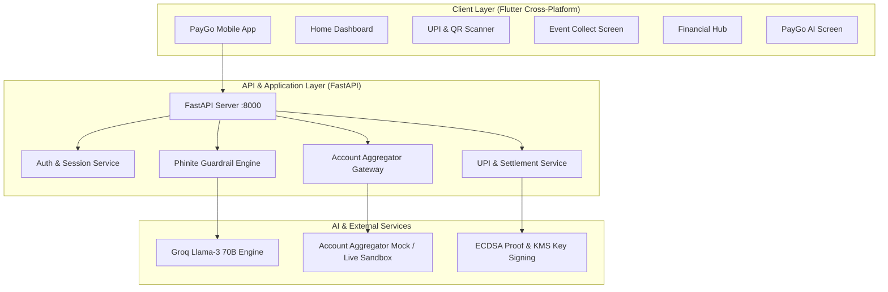

# 💳 PayGo — Next-Gen UPI & Autonomous Financial AI Ecosystem

<div align="center">


### *Empowering Payments, Account Aggregation, Cryptographic Event Collections, & AI-Driven Financial Guardrails*

[](https://flutter.dev)
[](https://fastapi.tiangolo.com)
[](https://www.python.org/)
[](https://groq.com)
[](https://sahamati.org.in/)
[](https://en.wikipedia.org/wiki/ECDSA)
[](LICENSE)

<br/>

<p align="center">
  <a href="#-interactive-demo-video">Interactive Demo Walkthrough</a> •
  <a href="#-project-overview">Project Overview</a> •
  <a href="#-key-features">Key Features</a> •
  <a href="#-architecture">System Architecture</a> •
  <a href="#-tech-stack">Tech Stack</a> •
  <a href="#-getting-started">Getting Started</a> •
  <a href="#-api-specifications">API Reference</a>
</p>

</div>

---

## 🎬 Interactive Demo Video

Because static screenshots cannot fully demonstrate live financial transactions and guardrail simulations, an interactive HTML demo walkthrough is bundled directly with the repository:

👉 **Open the standalone interactive video walkthrough**: [`demo_video.html`](./demo_video.html)

> **Features of the Demo Walkthrough Player:**
> - 📱 **Realistic device mockup** with live dynamic scene rendering (1080p 60FPS UI simulation)
> - ⏯ **Full playback controls**: Play, pause, scrubber seeking, next/prev chapter jump, and fullscreen mode
> - 🔍 **4 Interactive Chapters**:
>   1. **PayGo Core & UPI 2.0**: P2P transfers, bill recharges, dynamic QR generation.
>   2. **Event Collect & Settlement Proofs**: Group collections with dedicated UPI aliases and ECDSA cryptographic proof generation.
>   3. **Account Aggregator Financial Hub**: Multi-bank linking, consent management, automated expense categorization.
>   4. **PayGo AI Financial Advisor**: Guardrail-enforced financial chat powered by Llama-3 70B & deterministic checks.

---

## 🌟 Project Overview

**PayGo** is a comprehensive, production-grade fintech solution designed as the next evolution of mobile payments and personal financial management. 

Beyond conventional UPI apps, PayGo introduces **Event Collect** (verifiable, direct-to-bank group fundraising), an **RBI-compliant Account Aggregator Hub** (multi-bank consolidation and automated categorization), and **PayGo AI** (an autonomous financial co-pilot equipped with deterministic spending guardrails).

---

## ✨ Key Features

### 1. ⚡ Complete UPI 2.0 & Payments Engine
- **Instant Transfers**: Send money to mobile contacts, bank accounts, or arbitrary UPI IDs.
- **Dynamic QR Code Engine**: Generates standard NPCI UPI intent strings and deep links (`upi://pay?pa=...`).
- **Bill Fetch & Utility Payments**: Automated bill retrieval for electricity, DTH, broadband, piped gas, and mobile recharge.
- **Biometric & MPIN Security**: 4-digit UPI PIN authentication with simulated bank switch validation.

### 2. 🎯 Event Collect & Cryptographic Settlement Proofs
- **Custom Event Aliases**: Register dedicated handles (e.g. `tripgroup@paygo`) that resolve directly to the organizer’s linked bank account without custodial wallet risk.
- **Real-Time Settlement Ledger**: Automated transaction tagging with audit trail (`taggedBy`, `taggedAt`).
- **Cryptographic Audit Proof**: Generates a canonical SHA-256 snapshot and ECDSA signature when an event closes, creating a verifiable public proof of all funds received.

### 3. 🏦 RBI Account Aggregator Financial Hub
- **Consent-Driven Bank Linking**: Create, inspect, and revoke financial information provider (FIP) consents.
- **Portfolio Consolidation**: Aggregate balances, savings, and credit accounts across multiple financial institutions into a unified net worth metric.
- **Smart Categorization Engine**: Automatically classifies raw bank statements into Food, Utilities, Transport, Shopping, Investments, and detects recurring subscriptions.

### 4. 🤖 PayGo Autonomous Financial AI (Powered by Llama-3 70B & Phinite Logic)
- **Deterministic Guardrails**:
  - `SAFE`: Transactions within discretionary limits proceed smoothly.
  - `WARNING`: High-value transactions trigger cautionary notices.
  - `BLOCKED`: Transactions that would violate emergency minimum balances (e.g., ₹5,000 threshold) are stopped.
- **Interactive Financial Actions**: AI responses return actionable payloads such as dynamic expense bar charts and risk-profiled investment suggestions (Mutual Funds, High-yield FDs).

---

## 🏗️ System Architecture



---

## 🛠️ Tech Stack

| Domain | Technology / Library |
| :--- | :--- |
| **Frontend Framework** | **Flutter 3.x / Dart 3.11** (Android, iOS, Web) |
| **State Management** | **Flutter Riverpod 2.6** |
| **Routing & UI** | **GoRouter**, **Google Fonts**, **Flutter Animate**, **Shimmer** |
| **Backend Framework** | **Python 3.11+**, **FastAPI**, **Uvicorn** |
| **Data Validation** | **Pydantic v2** |
| **Cryptography** | **Python Cryptography** (ECDSA, SHA-256 digest creation) |
| **AI Inference** | **Groq Cloud API** (`llama3-70b-8192`) with JSON Schema validation |
| **QR & Documents** | **QR Flutter**, **PDF & Printing** |

---

## 🚀 Getting Started

### Prerequisites
- **Flutter SDK**: `>= 3.11.0`
- **Python**: `>= 3.10`
- **Git**

---

### Backend Setup

1. **Navigate to the backend directory:**
   ```bash
   cd paygo_backend
   ```

2. **Create and activate a virtual environment:**
   ```bash
   # Windows
   python -m venv venv
   .\venv\Scripts\activate

   # Linux / macOS
   python3 -m venv venv
   source venv/bin/activate
   ```

3. **Install dependencies:**
   ```bash
   pip install -r requirements.txt
   ```

4. **Launch the FastAPI server:**
   ```bash
   uvicorn main:app --reload --host 0.0.0.0 --port 8000
   ```
   *The interactive Swagger documentation will be available at `http://localhost:8000/docs`.*

---

### Frontend Setup (Flutter)

1. **Navigate to the app directory:**
   ```bash
   cd paygo_app
   ```

2. **Fetch Flutter dependencies:**
   ```bash
   flutter pub get
   ```

3. **Run on your connected Android device, emulator, or Chrome:**
   ```bash
   # Run on Chrome
   flutter run -d chrome

   # Run on connected Android device
   flutter run -d android
   ```

---

## 📖 API Specifications

| Method | Endpoint | Description |
| :--- | :--- | :--- |
| `POST` | `/auth/otp/request` | Initiates mobile OTP session |
| `POST` | `/auth/otp/verify` | Validates OTP and issues authentication token |
| `POST` | `/upi/alias/register` | Registers custom `@paygo` event VPA on user's bank account |
| `POST` | `/events` | Creates new collection event with target goal & expiry |
| `POST` | `/events/{id}/close` | Closes event and produces ECDSA cryptographic settlement proof |
| `GET` | `/verify/{id}` | **Public** audit endpoint to verify signed collection ledger |
| `POST` | `/api/financial/connect` | Initiates Account Aggregator consent artifact |
| `POST` | `/api/financial/accounts/sync` | Syncs statements and runs auto-categorization |
| `POST` | `/financial/check-payment` | Runs deterministic financial guardrail evaluations |
| `POST` | `/api/ai/chat` | AI chat completions with structured JSON actions |

---

## 🔒 Security & Privacy Guarantees

1. **Non-Custodial Architecture**: At no point do event collection funds stay in an intermediary PayGo wallet; all payments settle directly to NPCI-linked bank accounts.
2. **Immutable Proofs**: Event closure generates an irreversible SHA-256 digest with asymmetric digital signatures.
3. **Strict Data Consent**: Account Aggregator integration adheres strictly to revocable, purpose-limited data fetch policies.

---

## 📄 License

This project is licensed under the [MIT License](LICENSE).
