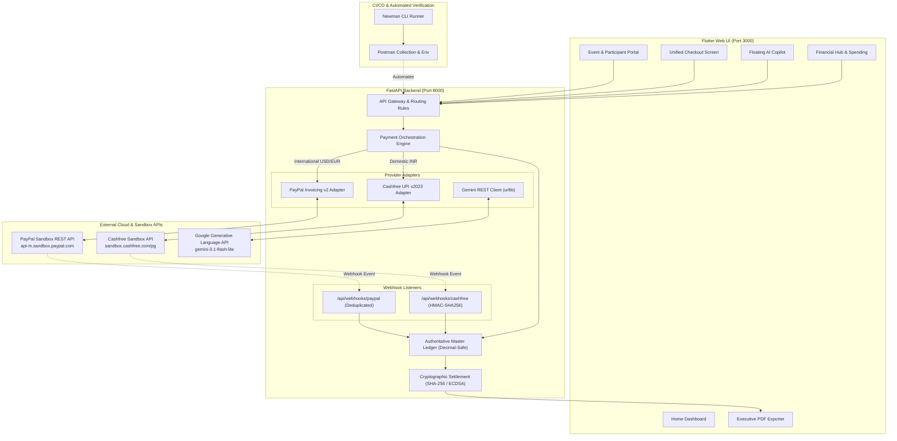

# EventLedger AI

> **Intelligent Event Finance & Payments**  
> *PayPal AI Hackathon 2026 Submission*

[](https://developer.paypal.com/)
[](https://ai.google.dev/)
[](https://fastapi.tiangolo.com/)
[](https://flutter.dev/)
[](https://www.npmjs.com/package/newman)
[](LICENSE)

---

## 1. Introduction

**EventLedger AI** is an intelligent, autonomous event finance platform combining PayPal payments, smart financial insights, account aggregation, and cryptographically verifiable settlement records. It empowers organizers to create events, collect payments, monitor finances, and generate audit-ready reports from one intelligent dashboard.

Designed specifically for modern tech conferences, hackathons, workshops, and community fundraisers, EventLedger AI eliminates the administrative friction of manual payment reconciliation, screenshot fraud, and spreadsheet audits.

---

## 2. Problem Statement

Organizers of group events, summits, and hackathons face three recurring pain points:
1. **Manual Tracking & Screenshot Fraud**: Organizers waste dozens of hours matching bank transfer screenshots or WhatsApp receipts against attendee spreadsheets.
2. **Payment Gateway Complexity**: Offering domestic payment options (e.g., UPI in India) alongside international methods (PayPal) usually requires fractured checkout flows and disjointed bookkeeping.
3. **Audit & Settlement Chaos**: Once an event concludes, proving that every participant paid and that final ledger totals are untampered requires painstaking manual auditing.

---

## 3. Solution Overview

EventLedger AI provides a unified, end-to-end financial operations platform:
- **Intelligent Payment Orchestration**: Evaluates the currency and payer geography to route transactions to the optimal gateway (Cashfree UPI for domestic INR, PayPal Invoicing v2 for international currencies like USD).
- **Grounded AI Financial Copilot**: Google Gemini 3.1 Flash-Lite reads verified application telemetry in real time to answer queries, summarize balances, and draft personalized reminders.
- **Unified Checkout Experience**: One responsive web checkout screen supporting both dynamic UPI QR codes and official PayPal Base64 invoice QR codes.
- **Cryptographic Settlement Ledger**: Event closure automatically generates an SHA-256 canonical ledger snapshot and digital signature.
- **One-Click Audit PDF**: Exports an executive financial report ready for stakeholders and auditors.

---

## 4. Key Features

- **Automated Invoicing Engine**: Integrates PayPal Invoicing REST API v2 with OAuth 2.0 to draft and send official invoices with email delivery suppressed (`send_to_recipient: false`).
- **Two-Level QR Architecture**:
  - *Level 1*: Public Registration Portal QR for attendee onboarding.
  - *Level 2*: Dedicated, individual PayPal Invoice Base64 QR code or dynamic UPI QR for payment execution.
- **Intelligent Payment Routing**: Server-enforced eligibility matrix that guarantees international attendees check out via PayPal while Indian domestic transactions are routed to UPI.
- **Floating AI Financial Copilot**: Conversational AI assistant available on every screen to answer collection questions, identify unpaid participants, and assist organizers.
- **Simulated Account Aggregator (Financial Hub)**: Interactive consent-based bank account linking, categorized spending analysis, and cashflow tracking.
- **Cryptographic Proofs & Tamper Detection**: Computes SHA-256 canonical snapshot hashes and ECDSA digital signatures upon event closing.
- **Automated Postman & Newman CI/CD Suite**: 13 automated requests across 5 suites with 26 assertions verifying idempotency, deduplication, and financial math.

---

## 5. Architecture Diagram



---

## 6. Complete Technology Stack

| Layer | Technologies |
| :--- | :--- |
| **Frontend** | Flutter Web (Dart 3.7+), GoRouter, Riverpod, Google Fonts, QR Flutter, PDF & Printing |
| **Backend** | Python 3.13, FastAPI, Uvicorn, Pydantic v2, Python `urllib` & `hmac` |
| **Payment Gateways** | PayPal REST API v2 (Invoicing & OAuth 2.0), Cashfree Payments PG API (v2023-08-01) |
| **Artificial Intelligence**| Google Gemini 3.1 Flash-Lite (`gemini-3.1-flash-lite`) via direct HTTPS REST |
| **Security & Cryptography**| Python `hashlib` (SHA-256 canonical hashing), ECDSA digital signatures, HMAC-SHA256 |
| **Automated Testing** | Postman 2.1 Collection, Newman CLI (v6.2.3), Python `unittest` |

---

## 7. PayPal Integration

The PayPal Developer integration forms the core international settlement backbone of EventLedger AI:

- **Sandbox REST Environment**: Configured with live Sandbox Business credentials targeting `https://api-m.sandbox.paypal.com`.
- **OAuth 2.0 Token Generation**: Retrieves and caches Bearer tokens securely on the server side using the Client Credentials grant. Secrets are never exposed to Flutter.
- **Invoicing API v2 Lifecycle**:
  - `POST /v2/invoicing/invoices`: Creates itemized invoices linked directly to participant registration records with decimal-accurate amounts.
  - `POST /v2/invoicing/invoices/{id}/send`: Sends the invoice with `send_to_recipient: false` to avoid spamming Sandbox email addresses while transitioning status to `SENT`.
  - `POST /v2/invoicing/invoices/{id}/generate-qr-code`: Retrieves the official PayPal-generated invoice QR code from PayPal's multipart/form-data response and extracts the raw Base64 image payload.
  - `GET /v2/invoicing/invoices/{id}`: Fetches real-time status and payment metadata directly from PayPal servers.
- **Hosted Payment Checkout**: Displays the official hosted checkout URL (`https://www.sandbox.paypal.com/invoice/p/...`) allowing participants to pay with a PayPal personal buyer account.
- **Verified Webhook Listener (`POST /api/webhooks/paypal`)**: Subscribes to invoice lifecycle events (`INVOICING.INVOICE.PAID`, `PAYMENT.SALE.COMPLETED`, `INVOICING.INVOICE.CANCELLED`), performs signature checks, and deduplicates event IDs to prevent double-crediting.

> **Current Test Status (Sandbox)**: Live Sandbox invoice creation and QR retrieval verified on PayPal servers:
> - **Invoice ID**: `INV2-H74E-BVRL-78AN-CX8C`
> - **Amount**: $50.00 USD
> - **QR Base64 Length**: 700 bytes
> - **Current Server Status**: `UNPAID` (Pending completion via personal sandbox buyer account).

---

## 8. Google Gemini AI Integration

EventLedger AI integrates Google's **Gemini 3.1 Flash-Lite** model to provide real-time, grounded financial operations:

1. **Natural-Language Financial Queries (`POST /api/ai/query`)**:
   - Organizers can ask: *"How much money have we collected?"*, *"Who hasn't paid yet?"*, or *"Give me an overview of our active summits."*
   - Responses are strictly grounded in live database records (`EVENTS`, `PARTICIPANTS`, and `LEDGER_ENTRIES`). Gemini does not invent balances or hallucinate payments.
2. **Conversational Intelligence**:
   - The system prompt is engineered to provide concise, direct answers (1–2 sentences) without unsolicited data dumps on greetings.
3. **Smart Payment Reminders (`POST /api/ai/generate-reminder`)**:
   - Drafts polite, personalized payment reminder notices for unpaid attendees, including their name, event fee, and registration deadline.
   - **Human-in-the-Loop Approval**: Generated reminders require explicit organizer consent before dispatch (`POST /api/ai/approve-action`).
4. **Natural-Language Event Creation (`POST /api/ai/parse-event`)**:
   - Parses unstructured event briefs (e.g., *"Create an AI Hackathon for 80 students at $30 each closing in 10 days"*) into structured JSON parameters for review.

---

## 9. Cashfree UPI Integration

EventLedger AI implements groundwork for Indian domestic payments using the **Cashfree Payments PG API (v2023-08-01)**:

- **Order Creation & Payment Sessions**: Generates unique `order_id` references, customer details, and payment session tokens.
- **Dynamic Order-Linked UPI QR**: Constructs standardized UPI Intent payloads (`upi://pay?pa=cashfree@icici&tr=...&am=...`) allowing attendees to scan and pay using apps like Google Pay, PhonePe, and Paytm.
- **Webhook Signature Verification**: Computes HMAC-SHA256 signatures over timestamp and raw request body using Cashfree client secrets (`x-webhook-signature`).

> **Status & Blocker Note**: The client adapter and local validation engine are fully implemented and verified via automated tests. Live transactions against `https://sandbox.cashfree.com/pg` are currently **BLOCKED (Merchant Activation Required)** because production/sandbox merchant credentials must be provisioned directly from the [Cashfree Merchant Dashboard](https://merchant.cashfree.com). The repository currently uses safe development placeholders.

---

## 10. Payment Eligibility & Routing Matrix

The backend enforces strict geographic and currency eligibility rules via `POST /api/payments/eligibility`:

| Payer Country | Currency | Selected Provider | Allowed Methods |
| :--- | :--- | :--- | :--- |
| **India (`IN`)** | `INR` | **Cashfree Payments** | UPI Intent, UPI QR, Net Banking |
| **International (`US`, `GB`, `EU`, etc.)** | `USD`, `EUR`, `GBP` | **PayPal Invoicing v2** | PayPal Wallet, Credit/Debit Card |
| **Cross-Border from India** | `USD`, `EUR` | **PayPal Invoicing v2** | PayPal International Gateway |

*Domestic Indian payments are strictly prohibited from using PayPal, aligning with Reserve Bank of India (RBI) guidelines.*

---

## 11. Financial Hub & Account Aggregation

The **Financial Hub** (`/financial-hub`) provides consolidated net worth and cashflow tracking:

- **Simulated Account Aggregator (AA) Consent Flow**: Implements a compliant multi-step consent journey (purpose specification, date ranges, data types) simulating RBI-regulated Account Aggregators.
- **Multi-Currency Ledger Segregation**: Calculates balances separately by currency (e.g., USD and INR totals are never conflated without explicit, timestamped exchange rates).
- **Spending Analytics & Insights**: Category breakdowns across Food, Transport, Bills, and Event Operations.

*(Note: Live bank linking uses high-fidelity mock banking definitions to demonstrate the user experience without requiring production NBFC-AA licenses).*

---

## 12. Cryptographic Settlement & Audit Integrity

To provide verifiable transparency for organizers, sponsors, and participants:

- **SHA-256 Canonical Snapshot Hashing**: When an event is closed (`POST /api/events/{id}/close`), the backend creates a canonical JSON representation of all confirmed attendees and transaction references, producing a cryptographic SHA-256 digest.
- **ECDSA Digital Signatures**: The digest is digitally signed using an elliptic curve private key (`secp256k1`), generating a verifiable signature string.
- **Tamper Detection**: Validated via automated tests; altering the event ledger by even 1 cent immediately invalidates the signature and fails the hash check.
- **One-Click Audit PDF Export**: The Flutter frontend immediately compiles the event metadata, ledger entries, and cryptographic settlement proof into a downloadable, print-ready PDF document.

---

## 13. System Requirements & Installation

### Prerequisites
- **Python**: 3.11 or 3.13
- **Flutter SDK**: 3.24+ / 3.41+ (Channel stable)
- **Node.js & npm**: Node 18+ (for Newman CLI test runner)
- **Chrome Browser**: For Flutter Web testing

### Installation Steps

1. **Clone the Repository**:
   ```bash
   git clone https://github.com/AP952005/eventledger-ai.git
   cd eventledger-ai
   ```

2. **Configure Backend Environment**:
   ```bash
   cp .env.example paygo_backend/.env
   # Edit paygo_backend/.env with your PayPal and Gemini API keys
   ```

3. **Install Backend Dependencies**:
   ```bash
   cd paygo_backend
   pip install fastapi uvicorn pydantic python-dotenv google-genai
   ```

4. **Install Frontend Dependencies**:
   ```bash
   cd ../paygo_app
   flutter pub get
   ```

5. **Install Newman CLI (Automated API Testing)**:
   ```bash
   npm install -g newman
   ```

---

## 14. Running the Application

### Start the FastAPI Backend
```bash
cd paygo_backend
python main.py
# Server runs on http://127.0.0.1:8000
# OpenAPI Swagger docs available at http://127.0.0.1:8000/docs
```

### Start the Flutter Web Frontend
```bash
cd paygo_app
flutter run -d chrome --web-port 3000
# Web client opens at http://localhost:3000
```

---

## 15. Automated Testing & Verification

### Running the Newman Postman Suite
The repository includes a comprehensive Postman test collection with automated assertions across all API endpoints:

```bash
newman run postman/EventLedger_AI.postman_collection.json -e postman/EventLedger_Local.postman_environment.json
```

**Newman Test Summary**:
- **Requests Executed**: 13
- **Assertions Evaluated**: 26
- **Test Failures**: 0 (**100% Pass**)

### Running Python Unit Tests
```bash
python -m unittest discover -s paygo_backend -p "test_*.py"
# 16/16 tests passing
```

---

## 16. API Route Reference

| Method | Endpoint | Description |
| :--- | :--- | :--- |
| `GET` | `/api/dashboard/overview` | Retrieves organization metrics and collection stats |
| `GET` | `/api/events` | Lists all active and closed events |
| `POST`| `/api/events` | Creates a new event with decimal-safe amounts |
| `POST`| `/api/events/{id}/register` | Registers an attendee and initiates invoice draft |
| `POST`| `/api/payments/eligibility` | Evaluates payer country/currency for gateway routing |
| `POST`| `/api/payments/orders/create` | Creates an internal order and payment attempt |
| `GET` | `/api/payments/orders/{id}/status`| Polls payment order status for browser recovery |
| `POST`| `/api/payments/orders/{id}/verify-sandbox` | Reconciles sandbox test transaction into master ledger |
| `POST`| `/api/webhooks/paypal` | Ingests and deduplicates PayPal webhook events |
| `POST`| `/api/webhooks/cashfree` | Ingests and verifies HMAC signatures for Cashfree webhooks |
| `POST`| `/api/ai/query` | Queries grounded financial telemetry via Gemini AI |
| `POST`| `/api/ai/generate-reminder` | Drafts personalized payment reminders |
| `GET` | `/api/financial/summary` | Consolidated multi-currency Financial Hub summary |
| `POST`| `/api/events/{id}/close` | Closes event and generates SHA-256 settlement proof |

---

## 17. Security & Financial Integrity

- **Decimal-Safe Arithmetic**: All calculations use Python's `Decimal` type, eliminating floating-point rounding discrepancies.
- **Zero Frontend Trust**: Payment confirmations are never granted from client-side redirects; the backend requires verified webhook payloads or direct server-to-server gateway reconciliation.
- **Idempotent Webhooks**: All incoming webhooks are tracked in `PROCESSED_WEBHOOKS` by event ID, preventing duplicate ledger entries or double-crediting.
- **Secret Isolation**: Provider credentials, access tokens, and private keys remain strictly server-side and are completely excluded from frontend code and git history.

---

## 18. Limitations & Future Roadmap

- **Cashfree Live Gateway**: Requires activating a merchant account on Cashfree's dashboard to replace test placeholders.
- **Database Persistence**: Currently operates on an in-memory domain model with seed data; planned migration to PostgreSQL via SQLAlchemy / Alembic.
- **Automated Payouts**: Future iterations will incorporate PayPal Payouts API and Cashfree Payouts for automated organizer settlement.

---

## 19. Repository Structure

```
eventledger-ai/
├── README.md                      # Comprehensive Hackathon Documentation
├── LICENSE                        # MIT Open Source License
├── .gitignore                     # Git ignore rules (protects .env and caches)
├── .env.example                   # Environment configuration template
├── postman/                       # Postman Collections & Environments
│   ├── EventLedger_AI.postman_collection.json
│   ├── EventLedger_Local.postman_environment.json
│   └── EventLedger_Sandbox.postman_environment.json
├── test-results/                  # Newman reports & test evidence
│   ├── END_TO_END_TEST_REPORT.md
│   ├── paypal-provider-evidence.json
│   ├── cashfree-provider-evidence.json
│   ├── settlement-proof-validation.json
│   └── gemini-qa-evidence.json
├── paygo_backend/                 # FastAPI Backend Service
│   ├── main.py                    # API Gateway & Route Handlers
│   ├── models.py                  # Pydantic Domain & Payment Models
│   ├── mock_data.py               # Seed Data & Ledger Stores
│   ├── services/
│   │   ├── paypal_service.py      # PayPal Invoicing REST v2 Client
│   │   ├── cashfree_service.py    # Cashfree PG API v2023-08-01 Client
│   │   └── gemini_service.py      # Google Gemini 3.1 Flash-Lite Client
│   ├── test_critical_requirements.py
│   └── test_eventtreasury.py
└── paygo_app/                     # Flutter Web Application
    ├── pubspec.yaml               # Flutter Dependencies
    └── lib/
        ├── config/                # Routes, Colors, and Themes
        ├── models/                # Client Data Models
        ├── services/              # API & PDF Services
        ├── screens/               # Event, Checkout, and Hub Screens
        └── widgets/               # Shell & Floating AI Copilot
```

---

## 20. Contributors & License

- **Author**: Abishek Palani Sivashanmugam ([@AP952005](https://github.com/AP952005))
- **License**: Released under the [MIT License](LICENSE).
